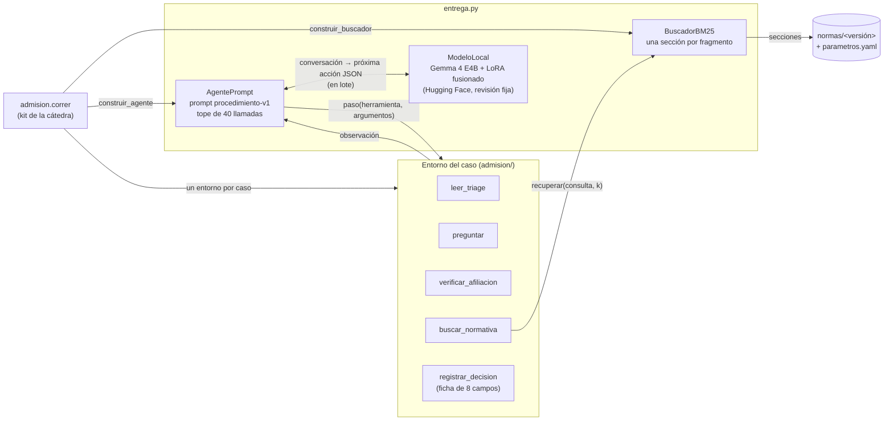

# TP final: la ficha de admisión de guardia

Entrega del grupo. Esta primera parte dice cómo correr todo **con el punto de control publicado y sin entrenar**.
Más abajo sigue, sin cambios, el [manual del kit de la cátedra](#manual-del-kit).

**Seguimiento:** [informe](INFORME.md) · [progreso y decisiones](docs/progreso.md) ·
[estándares compartidos](AGENTS.md) · enunciado en [mission.md](mission.md).

## Cómo correr la entrega

Qué se usa en la entrega (`entrega.py`, sin variables de entorno):

| Pieza | Valor | Dónde se fija |
|---|---|---|
| Modelo base | `google/gemma-4-E4B-it@ee0ef6023621cff504d758262d4e04895a5af4a2` | `admision_tp/configuracion.py` |
| Adapter LoRA | `FranCalveyra/tp-admision@770c9fac84d5718b0b2cf4c40c3451cad322ac9e`, carpeta `final` (repo HF **privado**; v39, desde 2026-11-13: antes de la decisión escribe `Edad: N años. Acompañante: X.`) | `ADAPTER_ENTREGA` en `admision_tp/configuracion.py` |
| Prompt | `configuraciones/prompts/procedimiento-v1.json` (sha256 verificado al cargar) | `RUTA_ENTREGA` en `admision_tp/prompts.py` |
| Buscador | BM25, una sección de las normas por fragmento, armado con la carpeta que recibe | `admision_tp/buscador.py` |
| Lote | 4 casos por micro-lote (el de todos los números reportados; `MODELO_LOTE` lo cambia) | `LOTE_ENTREGA` en `admision_tp/configuracion.py` |

### 1. Entorno

Linux con GPU CUDA. La cátedra corre en una A100 de 40 GB.

```bash
uv sync --locked                 # grupo `inferencia` por defecto: torch, transformers, accelerate, peft
export HF_TOKEN=<token de Hugging Face>   # la aplicación no lee .env sola
```

`HF_TOKEN` tiene que poder leer el modelo base y el repo privado `FranCalveyra/tp-admision`, compartido con la
cátedra. `WANDB_API_KEY` solo hace falta para entrenar. **No hace falta ninguna otra variable:** sin ellas,
`construir_agente()` usa lo de la tabla de arriba. `.env.example` lista las opcionales (lote, prompt, otro
adapter) y se puede exportar tal cual: deja comentadas las del adapter (`ADAPTER_REPO` vacío pediría el modelo
base sin adapter).

### 2. Un caso

El caso `pev-001` (dolor torácico: activa el circuito ECG), con las normas `b`:

```bash
mkdir -p corridas/un-caso && head -n 1 practica/casos.jsonl > corridas/un-caso/casos.jsonl
uv run python -m admision.correr practica --entrega entrega.py --casos corridas/un-caso/casos.jsonl \
    --esperadas practica/esperadas-b.jsonl --normas normas/b --salida corridas/un-caso/b
```

Qué se ve:

```bash
uv run python -m scripts.ver_caso corridas/un-caso/b
```

Muestra la conversación completa con el modelo (el mensaje de sistema resumido; `--sistema-completo` lo
muestra entero), cada búsqueda con las secciones de las normas que trajo el buscador, la ficha registrada y los
9 controles. Los datos crudos están en `corridas/un-caso/b/`: `trazas.jsonl` (`mensajes`, y en `log` cada
llamada a herramienta con su observación) y `resultados.jsonl`.

### 3. El buscador

```bash
uv run python -m admision.evaluar_rag --entrega entrega.py --normas normas/original --consultas rag/consultas_dev.jsonl
```

### 4. La evaluación completa

Los 50 casos de práctica con las normas original, b y c, en las cuatro filas del informe. Cada plan fija prompt
(con su sha256), adapter (revisión inmutable), buscador y lote; corre una vez por versión de las normas y deja
`runner.json` con la procedencia de cada corrida.

```bash
for plan in actual solo-prompt entrenado-v39; do   # sin_entrenar | solo_prompt | solo_entrenamiento y ambos (adapter 770c9fac)
  uv run python infra/kaggle_evaluacion.py --plan configuraciones/evaluacion/$plan.json \
      --salida corridas/evaluacion-$plan --dtype bfloat16 --device-map cuda:0
done
uv run python -m scripts.tabla_evaluacion --evaluacion corridas/evaluacion-actual \
    --evaluacion corridas/evaluacion-solo-prompt --evaluacion corridas/evaluacion-entrenado-v39 \
    --salida corridas/tabla-practica
```

`infra/kaggle_evaluacion.py` no depende de Kaggle: toma `HF_TOKEN` del entorno. Sus defaults (`float16`,
`device_map=auto`) son los de las T4 x2 donde corrimos; en A100 van los flags de arriba. La tabla (`tabla.md` y
`tabla.json`) puntúa cada corrida con `admision.correr.puntuar` y trae la procedencia de cada celda.
**Las corridas que reportamos están versionadas en [`evaluaciones/`](evaluaciones/README.md)** (conversaciones
completas, resultados caso por caso, `runner.json` y la tabla): se auditan y la tabla se regenera sin GPU. Detalle y
resultados en [evaluación](docs/evaluacion.md). La práctica solo se usa para reportar: prompt, datos y checkpoint se
eligieron en un conjunto de desarrollo aparte ([`datos/prompt-dev/v1`](docs/optimizacion-prompt.md)).

### 5. De dónde sale cada archivo

| Archivo | Script | Configuración y semilla |
|---|---|---|
| `historial_clasificado.csv`, `costumbres.md`, `historial_costumbres.json` | `python -m scripts.clasificar_historial` | Defaults del script: `historial/`, `normas/original/`; determinista |
| `datos/conversaciones/v3-procedimiento/` (2.900 conversaciones: trazas de referencia del kit, filas `correcta` del historial y 500 sintéticas; con ellas se entrenó el adapter) | `python -m scripts.generar_conversaciones --prompt configuraciones/prompts/procedimiento-v1.json --semilla 12012 --candidatos 5000` | `manifiesto.json`: commit, hashes de entradas, buscador |
| `datos/conversaciones/v2-baseline/` (mismas conversaciones con el prompt baseline) | `python -m scripts.generar_conversaciones --prompt configuraciones/prompts/baseline.json --semilla 12012 --candidatos 5000` | `manifiesto.json` |
| `datos/conversaciones/v4-aviso/` (633 de v3: refuerzo del aviso al voluntariado; experimento v36, no adoptado) | `python -m scripts.subconjunto_aviso --datos datos/conversaciones/v3-procedimiento/conversaciones.jsonl --salida datos/conversaciones/v4-aviso --otros 100 --semilla 15` | `configuraciones/sft-aviso.json` |
| `datos/conversaciones/v5-aviso-peso/` (1.133 de v3: aviso con peso en la pérdida) | `python -m scripts.subconjunto_aviso --datos datos/conversaciones/v3-procedimiento/conversaciones.jsonl --salida datos/conversaciones/v5-aviso-peso --otros 600 --semilla 15` | `configuraciones/sft-aviso-peso.json` |
| `datos/conversaciones/v6-aviso-datos/` (1.133 de v5: edad y acompañante copiados antes de la ficha) | `python -m scripts.anteponer_datos_aviso --datos datos/conversaciones/v5-aviso-peso/conversaciones.jsonl --salida datos/conversaciones/v6-aviso-datos` | `configuraciones/sft-aviso-datos.json` |
| `datos/entrenamiento/` (primera versión, #12; no la usa el adapter) | `scripts.seleccionar_entrenamiento`, `scripts.generar_sinteticos_entrenamiento` | `datos/entrenamiento/manifiesto.json` (semilla 12012) |
| `datos/prompt-dev/v1/` (conjunto de desarrollo, 40 casos) | `python -m scripts.generar_prompt_dev --semilla 20261110 --carpetas 2 --casos-por-carpeta 20 --candidatos 4000` | Excluye los casos de práctica |
| `configuraciones/prompts/procedimiento-v1.json` (prompt elegido) | Escrito a mano; elegido con `scripts.evaluar_prompts` + `scripts.rankear_prompts` en el conjunto de desarrollo | [Optimización de prompt](docs/optimizacion-prompt.md) |
| Adapter `final` en `FranCalveyra/tp-admision` | `scripts.preparar_entrenamiento` → `scripts.tokenizar_entrenamiento` → `scripts.entrenar --online --publicar` | `configuraciones/sft-ejemplo.json` (semilla 42, lr 2e-4, 1 época, LoRA r=8); corrida W&B `3add2742ddfd4b42`; cada checkpoint con su revisión HF |
| Adapter de la entrega (v39): continuación del anterior (`dc41674a`) sobre `datos/conversaciones/v6-aviso-datos/` | `scripts.entrenar --online --publicar` con `configuraciones/sft-aviso-datos.json` (semilla 42, lr 1e-4, 1 época, `peso_aviso` 20; 142 pasos) | corrida W&B `41ec01f292e64306`, código `5a36ecf`; `final` = `770c9fac`; recibos en `evaluaciones/entrenamiento/v39-datos/` |

Volver a entrenar ([entrenamiento SFT](docs/entrenamiento-sft.md)), con las mismas entradas y en una A100:

```bash
uv sync --locked --group entrenamiento
uv run python -m scripts.preparar_entrenamiento --datos datos/conversaciones/v3-procedimiento/conversaciones.jsonl \
    --configuracion configuraciones/sft-ejemplo.json --salida corridas/sft-preparada
uv run python -m scripts.tokenizar_entrenamiento --preparacion corridas/sft-preparada --salida corridas/sft-tokens
uv run python -m scripts.entrenar --preparacion corridas/sft-preparada --tokens corridas/sft-tokens \
    --salida corridas/sft --online --publicar
```

No hace falta para verificar nada: la entrega carga el adapter publicado. Nuestro entrenamiento corrió en Kaggle
(T4 x2, `infra/kaggle_entrenamiento.py` con `--precision fp16 --dispositivos auto`, ver [Kaggle](docs/kaggle.md)).

### 6. Diagrama



El agente le pasa al modelo la conversación entera y el modelo responde una acción JSON: qué herramienta llamar
y con qué argumentos. El entorno ejecuta la herramienta y devuelve la observación, hasta que el agente llama a
`registrar_decision`. Solo `buscar_normativa` usa el buscador; las normas se leen de la carpeta que recibe
`construir_buscador`, así que los números cambian con la versión y no están en los pesos.

## Limitaciones conocidas

- **A100 sin validar** ([KI-A100-001](#ki-a100-001--entrenamiento-evaluación-y-recursos-sin-validar-en-a100-40gb),
  cerrado como limitación aceptada): entrenamos y evaluamos en Kaggle T4 x2, porque decidimos no cargar una
  tarjeta de crédito en Modal. Los tiempos y la VRAM de T4 no valen para A100.
- **Acceso de la cátedra:** el repo HF y el proyecto W&B son privados. Hasta que la cátedra esté invitada (#16),
  su `HF_TOKEN` no puede bajar el adapter y `construir_agente()` falla con 401.

---

# Manual del kit

**Equipo:** para el entorno reproducible del proyecto (CPU, variables y Kaggle; Modal legacy), seguir [Preparar el entorno del equipo](docs/entorno-equipo.md).

El enunciado (qué hay que hacer, qué se entrega y cómo se corrige) está en [mission.md](mission.md), y el video que lo presenta en dos partes: [Parte 1](https://www.loom.com/share/2c56572757124aaf8e2a1e1398efe27d) y [Parte 2](https://www.loom.com/share/12f6cb81c76440cd8a86563dcc02b2f2). Esto explica qué trae el kit y cómo se usa.

## Qué trae

| Carpeta | Contenido |
|---|---|
| `normas/original/` | 20 secciones de las normas del hospital, una por archivo, y `parametros.yaml` con los valores |
| `normas/b/`, `normas/c/` | Las mismas normas con otros números, como hará el test de la cátedra |
| `practica/` | 50 casos de práctica (`casos.jsonl`) y la ficha esperada de cada uno con cada versión de las normas (`esperadas-<versión>.jsonl`) |
| `historial/historial.csv` | 2.000 admisiones pasadas, sin marcar |
| `rag/consultas_dev.jsonl` | Consultas con la evidencia esperada, para evaluar el buscador |
| `admision/` | El entorno, el comparador, el generador de casos, el agente de ejemplo, el programa que corre los casos y la evaluación del buscador |

Las normas citan a veces disposiciones generales (`NOR-GEN`) que no están entre los archivos. No hacen falta para
completar la ficha.

## Instalarlo

`admision/` es un paquete de Python que usa solo la biblioteca estándar y pyyaml.

- Para trabajar desde esta carpeta: `uv sync`, y los comandos de abajo se corren desde acá.
- Para usarlo desde el repositorio del grupo, agréguenlo a su entorno con la ruta a esta carpeta:
  `uv add <ruta a esta carpeta>` (o `pip install <ruta a esta carpeta>`). Así `import admision` funciona desde su código, y los mismos
  comandos corren desde su repositorio, con las rutas al kit.

No hace falta copiar `admision/` adentro del repositorio. Si lo copian, la cátedra lo reemplaza por su propia copia al
correr la entrega.

## El contrato de la entrega

El repositorio del grupo tiene un archivo de Python, por ejemplo `entrega.py`, con dos funciones:

```python
def construir_buscador(ruta_normas):   # arma el buscador con las normas de esa carpeta
    ...
def construir_agente():                # carga el modelo una sola vez
    ...
```

- **El buscador** tiene `recuperar(consulta, k)`, que devuelve una lista de objetos con atributo `texto` (o strings),
  de más a menos relevante. Si define `k_entorno`, esa es la cantidad que devuelve la herramienta `buscar_normativa`;
  si no, 2. En el test, los números de las normas cambian, así que el buscador se arma siempre con la carpeta que
  recibe (es una copia de las normas en una carpeta aparte). Si el buscador falla en una búsqueda, esa llamada vuelve
  como error (`Error: el buscador falló: <tipo de error>.`) y el caso sigue.
- **El agente** tiene `jugar_lote(entornos)`. Cada elemento de `entornos` es un caso, y tiene solo dos cosas: el id
  del paciente (`paciente_id`) y `paso(herramienta, argumentos)`, que devuelve la observación y si el caso terminó. El
  agente juega cada caso llamando a `paso` hasta `registrar_decision` y devuelve, por caso, la conversación completa
  con el modelo: cada mensaje que entró y cada uno que salió, en el mismo orden que `entornos`.
- **Tope de llamadas:** cada caso admite hasta 40 llamadas a herramientas. Si llega a 40 sin registrar la ficha, el
  caso termina sin ficha. Una llamada a un caso terminado devuelve `El caso ya terminó.` y no cuenta.
- **Fijos:** los nombres y argumentos de las cinco herramientas y los 8 campos de la ficha (ver
  `admision/ejemplo.py`). `registrar_decision` acepta además `fundamentos`, la lista de secciones de las normas que
  justifican la ficha: es optativo y no se corrige.
- **Libres:** el mensaje de sistema, el formato de los mensajes al modelo, la cantidad de búsquedas y la estrategia.
- **Formato del último mensaje:** el adapter v39 escribe `Edad: N años. Acompañante: X.`, un salto de línea y el JSON de
  `registrar_decision`. El texto previo no tiene llaves, así que `extraer_json` de la cátedra (`admision/ejemplo.py`) lo
  lee igual. La práctica con este adapter (Kaggle v40, solo para reportar) dio 36/28/36 en la fila `ambos`; ver [`evaluaciones/practica/tabla-v39`](evaluaciones/practica/tabla-v39/tabla.md).
- En operación, el agente no llama a ningún servicio externo.

`admision/ejemplo.py` es el agente de la referencia de la cátedra, con su mensaje de sistema. Pueden usarlo o
reemplazarlo entero.

## Correr la práctica

```bash
uv run python -m admision.correr practica --entrega entrega.py --casos practica/casos.jsonl \
    --esperadas practica/esperadas-original.jsonl --normas normas/original --salida corridas/original
```

Trabaja en dos fases, que también se pueden correr por separado:

1. **Jugar** (`python -m admision.correr jugar --entrega ... --casos ... --normas ... --salida ...`): arma el buscador
   y el agente y juega los casos, sin mirar las fichas esperadas. Deja en `--salida` las trazas (`trazas.jsonl`: por
   caso, la conversación completa, cada llamada a herramienta con lo que devolvió, y la ficha) y los tiempos
   (`tiempos.json`).
2. **Puntuar** (`python -m admision.correr puntuar --trazas .../trazas.jsonl --esperadas ... --salida ...`): compara
   cada ficha con la esperada. Deja el resultado caso por caso (`resultados.jsonl`) y el resumen (`resumen.json`).

`jugar` no arranca si encuentra un archivo `esperadas-*.jsonl` en la carpeta desde la que se corre, en la de los casos,
en la de las normas o en alguna de las tres carpetas de arriba de la de las normas. Como `practica/` tiene los casos y
las esperadas juntos, para correr `jugar` solo, copien `practica/casos.jsonl` a otra carpeta. `practica` lo hace por su
cuenta: copia los casos y las normas a una carpeta temporal y juega ahí.

Un caso está resuelto si pasan los 9 controles: los 8 campos de la ficha y la verificación de la afiliación. Es el
formato que se exige para cada número que se reporta.

**Tiempos y contexto.** El tiempo lo mide `admision.correr`, no el agente: cuánto tarda `construir_agente`, cuánto
tarda `jugar_lote` entero y, por caso, en qué segundo hizo su última llamada (los casos de un lote corren a la vez).
Los caracteres de contexto (lo que se le pasó al modelo en todo el caso) salen de la conversación que devuelve el
agente, así que esa conversación tiene que ser completa.

Si `jugar_lote` se cae a mitad de camino, las trazas igual se escriben con lo que llegó a pasar en cada caso, y el
error queda anotado en `tiempos.json` y en el resumen.

## Cómo corre la cátedra su entrega

- Cada entrega corre en un proceso propio, en una GPU A100 de 40 GB (no la de 80 GB), sin tiempo máximo.
- La cátedra instala las dependencias fijadas en el repositorio del grupo y su propia copia de `admision` (si el
  repositorio trae una, la reemplaza).
- El modelo se baja del repositorio de Hugging Face del grupo. Por eso `construir_agente()` lee el id del repositorio
  y la revisión (el commit o la etiqueta exacta del modelo) desde el código o la configuración del grupo. La cátedra
  pone en el entorno `HF_TOKEN`, la clave que le da acceso a ese repositorio privado.
- Las dos fases corren por separado: primero `jugar`, en una máquina que tiene solo los casos y las normas del test
  secreto, y después `puntuar`, en otra, con las fichas esperadas. El agente nunca ve las fichas esperadas.

## Evaluar el buscador

```bash
uv run python -m admision.evaluar_rag --entrega entrega.py --normas normas/original --consultas rag/consultas_dev.jsonl
```

Mide si el buscador trae la evidencia (recall), qué parte de lo que trae sirve (precisión) y cuántos tokens trae, con lo
que el buscador devuelve en el entorno (`k_entorno`) y con presupuestos fijos de 256, 512 y 1024 tokens. Es una
evaluación obligatoria antes de empezar el agente, y se documenta. No es la nota: el buscador cuenta por lo que rinde
el agente con él.

## Generar casos

```python
from admision.generador import generar
casos = generar(semilla=42, n=1000)
```

Son casos sin la respuesta. La ficha correcta hay que deducirla de las normas y del historial.

## El historial

Una fila por admisión pasada, como la exportación del sistema de admisión:

- **Identificación:** id de la fila, fecha y operador.
- **Lo que decía el triage:** edad, nivel, motivo, nota de enfermería, sospecha de sepsis, llegada, documento,
  credenciales, si podía responder, acompañante y si se lesionó trabajando.
- **Lo que averiguó el operador:** cobertura declarada, ART declarada y la entidad y el número que verificó, con la
  respuesta de la entidad.
- **La ficha que completó:** los 8 campos.

No está marcado. Hay filas correctas, errores y ruido, y el hospital tiene costumbres que no están escritas en las
normas.

**Qué se entrega de la clasificación:**

- `historial_clasificado.csv`, con dos columnas, `id,tipo`, y una fila por cada fila del historial (las 2.000).
  `tipo` es uno de estos tres valores:
  - `correcta`: la fila sigue las normas escritas y hace lo que hacen casi todos los operadores;
  - `error`: la fila viola una norma escrita;
  - `ruido`: la fila hace algo que las normas no cubren, distinto de lo que hacen casi todos los operadores en esa
    situación (o sea, se aparta de una costumbre).
- `costumbres.md`, en texto libre: cada costumbre que descubrieron, explicada, con los ids de las filas que la
  respaldan.

Instrumentación: [configurar W&B y probar sin conexión](docs/wandb.md).


## Known Issues — añadido del equipo (no modifica la consigna)

### KI-A100-001 — Entrenamiento, evaluación y recursos sin validar en A100-40GB

**Estado: cerrado (2026-11-14) como limitación aceptada, no resuelta.** La entrega **no está validada en A100**:
todo se entrenó, evaluó y midió en **Kaggle T4 x2**, y los tiempos y la VRAM de T4 no valen para A100.

- **Por qué:** fue una **decisión consciente** del equipo. Modal, la plataforma que sugiere la consigna para la
  A100, pide cargar una tarjeta de crédito para habilitar el crédito gratis, y decidimos no hacerlo (2026-11-05).
  No había otra vía a una A100 de 40 GB: el notebook de Kaggle no la ofrece ([evidencia y alcance](docs/kaggle.md)).
- **Qué implica:** la consigna pide A100 de 40 GB para entrenar y para correr
  ([mission.md](mission.md#modelo-y-cómputo)), y los recursos medidos en ese hardware ([Parte 5](mission.md#el-informe)).
  Eso no lo cumplimos. No hay una excepción acordada con la cátedra.
  - Los recursos que reporta el [informe](INFORME.md#parte-5-recursos) son de T4.
  - Lo de A100 queda como proyección, marcado PENDIENTE.
- **Riesgo para la corrida de la cátedra:** en T4 la entrega usa 19,94 GB de pico repartidos en 2 GPU, en fp16 y con
  lote 4. En una A100 de 40 GB se espera que entre (bf16, `cuda:0`), pero no está probado.
- **Por qué se cierra:** no queda ninguna acción pendiente. La limitación está declarada en el informe y se va a
  mencionar en el mail de entrega. Las corridas en T4 siguen siendo evidencia de desarrollo, separada de cualquier
  validación en A100.
